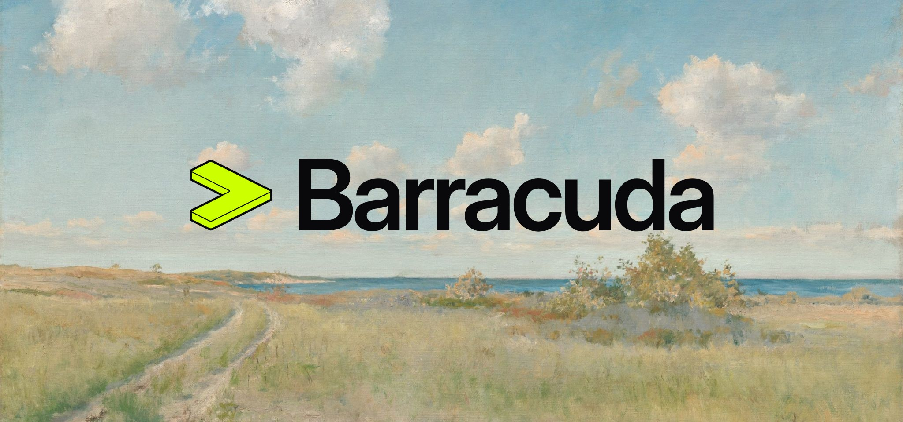

<a href="https://barracuda-os.vercel.app">
    
</a>
&nbsp;

<p align="center">
  <a href="https://barracuda-os.vercel.app">Website</a>
  ·
  <a href="https://barracuda-os.vercel.app/#product">Product</a>
  ·
  <a href="https://barracuda-os.vercel.app/#ladder">How it works</a>
  ·
  <a href="https://barracuda-os.vercel.app/#plugins">Plugins</a>
  ·
  <a href="https://barracuda-os.vercel.app/boards/">Boards</a>
  ·
  <a href="https://barracuda-os.mintlify.site">Docs</a>
  ·
  <a href="https://github.com/robcholz/barracuda/releases">Changelog</a>
  ·
  <a href="README.zh-CN.md">简体中文</a>
</p>

> [!NOTE]
> Flash a board from your browser and test ideas on it live.
> [Get started](https://barracuda-os.mintlify.site/get-started/installation).

> [!WARNING]
> Barracuda is in early, rapid development. Plugin contracts, board files,
> settings, and the device APIs can change from one commit to the next, and
> there is no stable release yet. If you build on Barracuda, pin a commit.

<h1></h1>

## About

[Barracuda](https://barracuda-os.vercel.app) lets you build embedded products at
the speed of AI. It is an embedded platform where every feature is a plugin.
Compose firmware in minutes, add an AI agent, and test ideas live on real
hardware. The same code runs on ESP32, STM32, Linux, and macOS.

**8** platforms · **80** boards · **44** built-in plugins · **6** ways to chat

## Installation

[Install in browser](https://barracuda-os.mintlify.site/get-started/installation):
pick your board, plug it in, done in minutes. It works in desktop Chrome or
Edge.

Or build from source with the Rust toolchain:

```bash
git clone https://github.com/robcholz/barracuda && cd barracuda
cargo board select && cargo run
```

No board yet? Select `local-linux` or `local-macos` and try it on your computer
first. [Read the docs](https://barracuda-os.mintlify.site) for every step.

## What makes it fast

Embedded work usually means an edit-compile-flash loop for every change,
firmware built by hand, and code tied to one vendor. Barracuda replaces all
three.

- **Test on real hardware, instantly.** Describe a behavior and the AI agent
  writes a script and runs it on the board. No compiling, no flashing: change
  it and see the result right away.
  [How live scripts work →](https://barracuda-os.mintlify.site/use/scripts)
- **Every feature is a plugin.** Pick what this product needs and build. What
  you leave out isn't in the firmware at all, and your coding agent writes the
  plugins you're missing.
  [Explore plugins →](https://barracuda-os.mintlify.site/plugins/overview)
- **No vendor lock-in.** Your plugins and scripts run unchanged on ESP32,
  STM32, Linux, and macOS. Switch chips without a rewrite, or start on your
  laptop before the board arrives.
  [See supported boards →](https://barracuda-os.vercel.app/boards/)

## Start in minutes. Go as deep as you want.

Six levels, from chatting with your board to building your own firmware. Each
one works on its own, so stop wherever you like.

1. **Chat with your board.** Install from the browser, then tell your board what
   to do. The AI agent writes a script and runs it right away.
2. **Choose your features.** Pick the features your project needs, such as
   Wi-Fi, a screen, or WeChat, then build and install. Features you leave out
   take no memory.
3. **Build apps.** Describe an app and the Live Editor builds its screens and
   logic. Preview it, refine it, and install it over USB.
4. **Add new hardware.** Ask Claude Code, Cursor, or Codex to add support for a
   new sensor or service. Its work follows the same rules and tests as the
   built-in features.
5. **Add a new board.** Tell your coding tool the board's chip and parts, and it
   adds the board. Users can then install on it from the browser.
6. **Build custom firmware.** Give your coding tool the chip, the memory budget,
   and the job. It keeps only the features you need, writes what's missing, and
   builds firmware that fits.

## Chat from the apps you already use

Talk to your board from WeChat, Telegram, QQ, or the web. Keep a separate
conversation for each project and switch between them in any app. Your settings
and keys stay on your board; conversations go to the AI provider you choose.

## Bring your board to Barracuda

Add your board once. Anyone can then install Barracuda on it from the browser
and control its hardware by chatting. A board is one short file with its chip,
build target, and memory layout, or your coding tool can write it for you with
the `create-board` skill. Read the
[board guide](https://barracuda-os.mintlify.site/boards/overview).

## Licensing

Barracuda is licensed under the [AGPL v3](LICENSE). Directories that carry
their own `LICENSE` file, such as vendored third-party code, are licensed under
that file.

To ship Barracuda in a closed-source product, email
[finn.robcholz.dev@gmail.com](mailto:finn.robcholz.dev@gmail.com) about a
commercial license.

## Open Source & Contributing

Barracuda is open source and lives in this repository: drivers, apps, and
custom firmware in one Rust repo, with the coding tools you already use. We
welcome community contributions, from new plugins and boards to fixes and docs.
For the full contribution flow, read our [CONTRIBUTING.md](CONTRIBUTING.md)
guide.

> [!TIP]
> **Work with your coding agent.** The repository includes
> [skills](.agents/skills/), ready-made instructions that teach Claude Code,
> Cursor, and Codex to add hardware with `create-plugin`, add boards with
> `create-board`, and add chips with `create-platform`.

### Issue to PR

Before filing, [search existing issues](https://github.com/robcholz/barracuda/issues)
for your bug or feature request. If nothing exists,
[report an issue](https://github.com/robcholz/barracuda/issues/new) with the
board you use and the steps to reproduce it. Before your first pull request is
merged, accept the [Contributor License Agreement](CLA.md) as
[CONTRIBUTING.md](CONTRIBUTING.md#contributor-license-agreement) describes.

### Building the Repo Locally

To build and run Barracuda from source on your computer:

```bash
cargo board select local-linux                      # or local-macos, or any board under boards/configs/
sudo sh platforms/linux/provision.sh barracuda0     # Linux only, once per boot
BARRACUDA_VIRTUAL_IO_ADDR=127.0.0.1:7878 cargo run  # build and run
cargo fmt --all --check                             # formatting, as CI checks it
```

See [AGENTS.md](AGENTS.md) for the engineering guide, including the plugin
contract, the platform architecture, code style, and how to write docs.

## Support and Questions

1. See our [docs](https://barracuda-os.mintlify.site) for a guide to every
   level, in English and [Simplified Chinese](https://barracuda-os.mintlify.site/zh).
2. [Report an issue](https://github.com/robcholz/barracuda/issues) to ask a
   question or get help with a board.
3. Follow the [changelog](https://github.com/robcholz/barracuda/releases) to see
   what's new.

## Code of Conduct

We ask everyone to be respectful and empathetic. Barracuda follows the
[Code of Conduct](CODE_OF_CONDUCT.md). To report violations, email
[finn.robcholz.dev@gmail.com](mailto:finn.robcholz.dev@gmail.com).

## Open Source Dependencies

We'd like to call out a few of the open source projects Barracuda is built on:

- [Embassy](https://github.com/embassy-rs/embassy)
- [esp-hal](https://github.com/esp-rs/esp-hal)
- [Lua](https://www.lua.org)
- [picoserve](https://github.com/sammhicks/picoserve)
- [reqwless](https://github.com/drogue-iot/reqwless)
- [embedded-graphics](https://github.com/embedded-graphics/embedded-graphics)
- [heapless](https://github.com/rust-embedded/heapless)
- [Tokio](https://github.com/tokio-rs/tokio)
